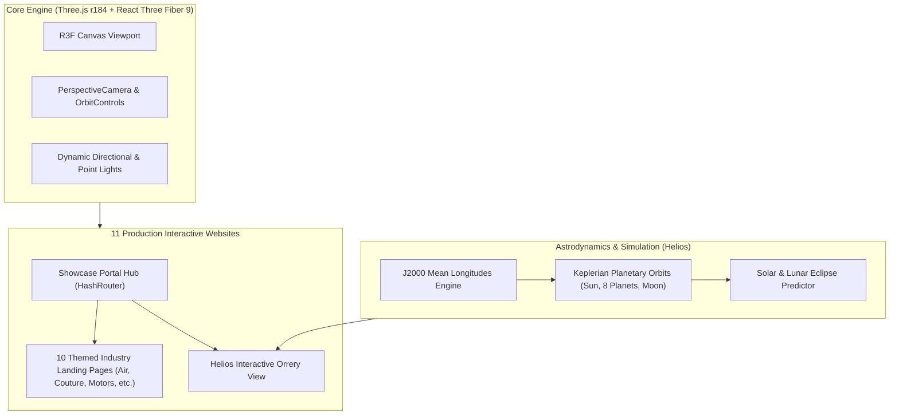

<div align="center">

# ☀️ Fable 5 · 3D Website Showcase

**Eleven photo-real, long-form 3D websites in one React codebase** —
ten cinematic industry landing pages, plus **Helios**: a live solar-system
simulator that predicts real solar eclipses.

[](https://github.com/codewithmuh/fable5-websites/releases)
[](https://opensource.org/licenses/MIT)
[](https://github.com/codewithmuh/fable5-websites/stargazers)
[](https://github.com/codewithmuh/fable5-websites/network/members)
[](https://react.dev)
[](https://vite.dev)
[](https://threejs.org)
[](https://docs.pmnd.rs/react-three-fiber)
[](https://www.youtube.com/@codewithmuh)

*Real photography · 3D depth everywhere · an enterprise-grade animation layer · zero backend*

</div>

---

## 3D Rendering & Animation Architecture



---

## ⚡ Quick start

```bash
npm install
npm run dev
```

Open **http://localhost:5173** — the hub lists all 11 sites. Filter them by theme,
flip the hub between dark/light, click any card to dive in, and use the
**← All sites** pill to come back.

```bash
npm run build   # static output — HashRouter means it deploys anywhere, no server config
```

---

## 🗺️ The 11 sites

| # | Route | Brand | Vibe | Theme |
|:-:|---|---|---|---|
| 01 | `/#/airline` | **Skyline Air** | Jet wing over golden clouds, cursor-spotlight hero | Dark |
| 02 | `/#/fashion` | **Maison Lumière** | Editorial couture, spotlight reveal | Light |
| 03 | `/#/automobile` | **Vektor Motors** | Black on black, headlights on | Dark |
| 04 | `/#/tourism` | **Wanderor** | Turquoise water, floating islands | Light |
| 05 | `/#/realestate` | **Halo Estates** | Warm ivory, villas at blue hour | Light |
| 06 | `/#/restaurant` | **Ember & Oak** | Burgundy glow, candle-dark rooms | Colored |
| 07 | `/#/fitness` | **Forge Athletics** | Iron, fog and sparks | Dark |
| 08 | `/#/tech` | **NeuraCore** | Vivid gradients, wireframe neural sphere | Colored |
| 09 | `/#/music` | **Pulse Festival** | Neon purple, lasers over 80,000 hands | Colored |
| 10 | `/#/jewelry` | **Aurelle** | A solitaire under a cursor spotlight | Dark |
| 11 | `/#/solar` | **Helios** | A live solar system that predicts real eclipses | ✨ Simulation |

---

## 🌘 Site 11: Helios — the eclipse predictor

The eleventh site is a feature demo, not a template: a full-screen Three.js
**orrery** running the Sun, all 8 planets and the Moon on their **real J2000
mean longitudes and mean motions**, with the Moon's 5.14° orbital tilt and the
18.6-year regression of its nodes. Drag to orbit the camera; run time from
paused up to six months per second.

Hit **“◉ Predict next solar eclipse”** and the simulation:

1. **Newton-iterates** to each upcoming new moon (Moon–Sun elongation = 0),
2. checks the Moon's distance from an orbital **node** —
   within **15.5°** → an eclipse happens somewhere on Earth;
   within **10.5°** → central (*total* near perigee, *annular* near apogee),
3. **fast-forwards the orrery** to the date with eased time acceleration,
4. and presents an animated result card — a dark moon disc crossing a glowing corona.

The same math renders a live list of the **next six solar eclipses**, recomputed
in your browser on every load — no API calls, no datasets, just ~80 lines of
closed-form astronomy in [`src/data/astro.js`](src/data/astro.js).

> **Accuracy check** — within ±1 day of the NASA eclipse catalog:
>
> | Predicted | Type | Reality |
> |---|---|---|
> | 13 Aug 2026 | Total | ✅ 12 Aug 2026 (Spain / Iceland) |
> | 6 Feb 2027 | Annular | ✅ 6 Feb 2027 — exact |
> | 2 Aug 2027 | Total | ✅ 2 Aug 2027 — exact (the “Great Eclipse” over Egypt) |
> | 26 Jan 2028 | Annular | ✅ 26 Jan 2028 — exact |

---

## 🎬 What every landing page includes

A long-form, 11-section cinematic scroll:

1. **Full-screen photo hero** — mouse parallax, floating popped-out 3D photo cards, and a transparent Three.js overlay unique to each industry (clouds, speed lines, lasers, sparkles, neural net, embers…)
2. Scrolling **marquee** strip
3. Feature grid of **3D tilt-on-hover** photo cards
4. **Split section** — popped 3D photo + copy with bullets
5. Full-width **parallax photo banner**
6. Photo **gallery** grid
7. Reversed split section
8. Centered **testimonial** quote
9. **Count-up stats** row
10. **CTA** photo banner
11. Minimal footer

Every section reveals with a 3D scroll animation — rise + un-tilt via
IntersectionObserver, staggered across grids.

### ✨ The animation layer

| | |
|---|---|
| **Kinetic headlines** | word-by-word rise-and-rotate reveal on load |
| **Three hero variants** | floating-cards photo hero · cursor-spotlight reveal · aurora panel hero |
| **Custom cursor** | accent dot + trailing ring that grows over links |
| **Magnetic buttons** | lean toward the cursor, diagonal shine sweep |
| **Count-up stats** | ease-out-quart, preserves `$ % ,` formatting |
| **Hub extras** | dark/light toggle, theme filter pills, staggered card entrances |
| **Everywhere** | scroll-progress bar, parallax banners, film-grain overlay, drifting gradient blobs |

---

## ✨ Copy Prompt

Every page — hub included — has a floating **✨ Copy Prompt** button
(bottom-right). It copies the full generation prompt for that design so anyone
can recreate a similar site with Claude.

📋 **All the prompts are written up in [PROMPTS.md](PROMPTS.md)** — the base
template, every per-industry variation, the shared animation layer, and the
standalone Helios + hub prompts. The live in-app copies live in
[`src/data/prompts.js`](src/data/prompts.js).

---

## 📁 Project structure

```
src/
├── components/
│   ├── Shared.jsx        # the whole design system: heroes, tilt cards, splits,
│   │                     #   marquee, stats, cursor, buttons, SiteTemplate…
│   └── threeUtils.js     # soft-circle sprite texture for particles
├── data/
│   ├── astro.js          # ☀️ the eclipse engine — J2000 mean-longitude astronomy
│   ├── images.js         # every photo URL, verified to load
│   └── prompts.js        # the generation prompt behind each site
└── pages/
    ├── Hub.jsx           # starfield hub with filters + theme toggle
    ├── SolarSystem.jsx   # 🌘 Helios: live orrery + eclipse prediction
    └── …                 # the ten industry sites
```

---

## 🛠️ Stack

**Vite · React 19 · Three.js · @react-three/fiber · @react-three/drei · react-router-dom** — photography from Unsplash & Pinterest.

<div align="center">

*Built with Claude Fable 5 — every site here started as a single prompt.*

</div>
